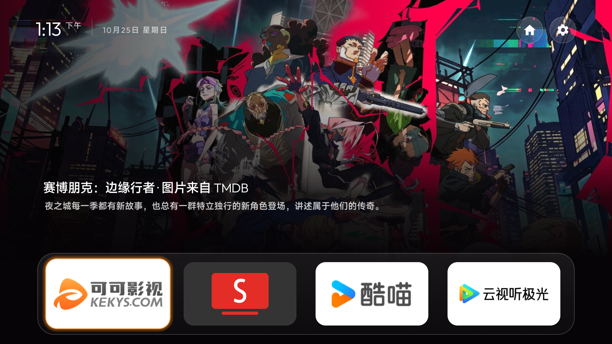
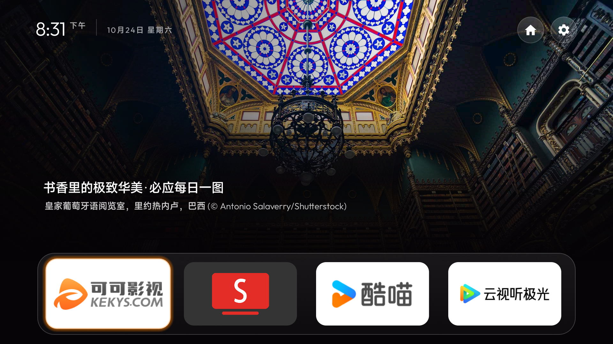
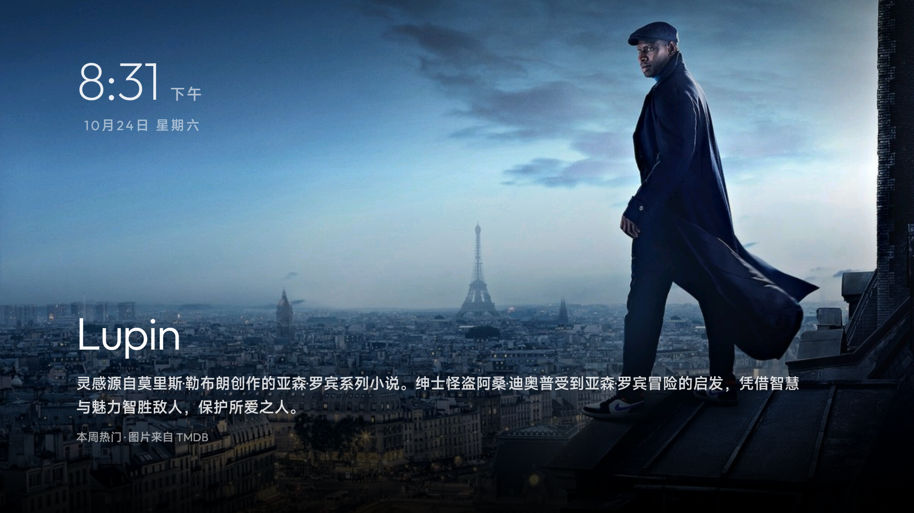

# Reel TV · 剧照桌面

  

**把电影剧照、风景与常用应用放回电视首页。**

Reel TV 是一款面向小米／红米 Android 电视的开源桌面。全屏背景搭配小时钟、影片名称和简介，底部保留常用应用；闲置时，已缓存的剧照会变成轮播屏保。无需 root，保留原厂桌面。

[**下载最新正式版**](https://github.com/tpxcer/reel-tv/releases/latest) · [安装与使用](docs/guide.md) · [主题配置](themes/README.md)

## 可以做什么

- **电影剧照首页**：TMDB 本周热门电影与剧集背景，显示对应片名、来源和最多三行简介。
- **四种背景来源**：在电视上切换 TMDB 热门剧照、必应每日一图、场景壁纸或自己的海报。
- **剧照屏保**：轮播已缓存的 TMDB 图片，带时钟、日期、影片名称和简介。
- **常用应用底栏**：通过应用库添加应用，长按调整位置，设置底栏透明度。
- **遥控器操作**：针对已测试的小米固件处理 Home 返回与待机恢复，保留原厂桌面入口；长按音量、小爱已通过实机验证。
- **电视内检查更新**：在设置页下载新版，核对 SHA-256 后交系统安装器确认，升级保留设置和 TMDB 密钥。

## 界面截图

| 必应每日一图 | TMDB 剧照屏保 |
|:---:|:---:|
|  |  |
| 每日风景与图片版权信息 | 闲置时轮播已缓存的剧照 |

以上为真实电视运行截图，拍摄于 2026 年 10 月 24–25 日；底栏应用为用户自行安装的示例。剧照来自 TMDB，必应图片版权归原作者，截图保留界面署名。

## 开始使用

1. 从 [Releases](https://github.com/tpxcer/reel-tv/releases/latest) 下载正式版 APK。
2. 按 [安装与使用](docs/guide.md) 完成首次安装、电视配置和 Home 辅助服务授权。
3. 长按右上角设置齿轮，进入「简洁桌面设置」，选择背景；使用 TMDB 时填写自己的 API 密钥。
4. 以后在同一设置页选择「检查更新」，按系统弹窗确认安装。

Reel TV 用于展示图片和打开已安装的应用，不提供影视播放或片源。

首次安装需要电脑通过 ADB 配置。TMDB 密钥由使用者自行申请，在电视上填写，应用不内置密钥。详细申请、权限用途和恢复方法见 [使用指南](docs/guide.md)。

## 兼容性

| 项目 | 说明 |
|---|---|
| 系统要求 | Android 8.0 及以上（minSdk 26） |
| 已实测设备 | Redmi MiTV-ASTP0，Android 9 / SDK 28 |
| 已实测固件 | 25.6.6.OS2.0.19.0.PSTAATV |
| 正式版包名 | `io.github.tpxcer.reel` |
| 其他型号 | 尚未验证，Home 接管和屏保行为取决于系统实现 |

本机型需保留原厂桌面，并在配置中保持 `key_filter=false`，以维持长按音量正常。首次配置前请阅读 [小米／红米安装说明](docs/guide.md)。

## 文档与开发

- [安装与使用](docs/guide.md)：安装、升级、TMDB 密钥、权限、已知问题、卸载与构建。
- [主题配置](themes/README.md)：布局、底栏、背景及其他配置项。
- [应用库](docs/app-library.md)：添加与整理应用。
- [天空背景](docs/sky.md) · [继续观看](docs/watch-next.md)。

构建需要 JDK 17 和 Android SDK 34。构建命令、调试签名与正式版升级注意事项见 [使用指南](docs/guide.md)。

## 许可与致谢

Reel TV 使用 [MIT 许可证](LICENSE)。部分代码、主题和工具来自 Gathin 的 [CleanYourTV](https://github.com/Gathin23/cleanyourtv)，保留其 MIT 版权声明；其余部分版权归 tpxcer。

本产品使用 TMDB API，但未获 TMDB 认可或认证。图片与影视内容的权利归各自权利人所有。安全问题请通过仓库的 [Security](https://github.com/tpxcer/reel-tv/security) 页面私下报告。

---

**English:** Reel TV is an open-source home screen for Xiaomi/Redmi Android TVs, with TMDB backdrops and synopses, Bing's image of the day, custom pictures, an app dock and a slideshow screensaver. Use your own TMDB key. Tested on one Redmi Android 9 TV; compatibility with other models is unverified. See the [setup guide](docs/guide.md).
